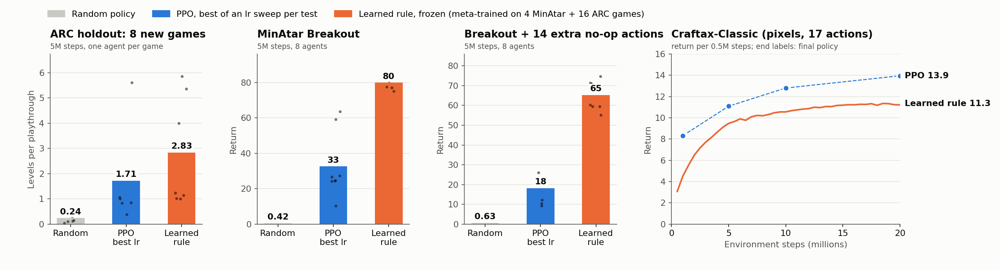
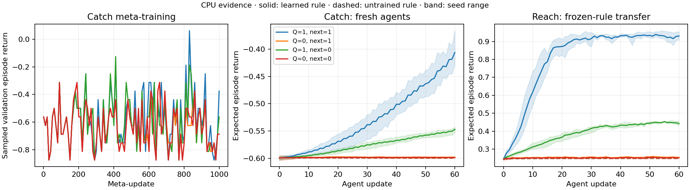
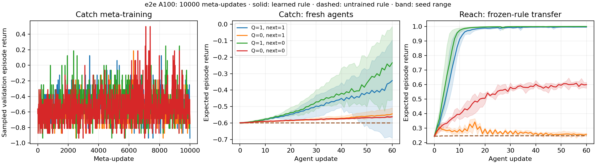

# nanoDisco

A compact educational DiscoRL-style JAX implementation: a pixel agent learns
from targets emitted by a reverse GRU, and a **separate learned meta-critic**
supplies the outer meta-gradient. The core is about 350 lines. No pretrained
weights, optimal-action labels, reward shaping, or oracle training are used.



*One learned update rule, frozen after meta-training, against PPO with a tuned learning rate: it beats PPO on 8 unseen ARC games and on MinAtar Breakout, and trails it on Craftax-Classic pixels.*

## Run

Python 3.12 was tested on the Mac:

```sh
uv venv --python 3.12
uv pip install --python .venv/bin/python -r requirements-lock.txt
source .venv/bin/activate
python -m unittest -v

python disco.py --q    --next-policy    --out results/full
python disco.py --no-q --next-policy    --out results/no_q
python disco.py --q    --no-next-policy --out results/no_next
python disco.py --no-q --no-next-policy --out results/neither
python plot.py results/full results/no_q results/no_next results/neither
```

Defaults: 1,000 meta windows, two inner updates per window, 32 environments,
64 agent updates per lifetime, one meta seed (0). Critic parameters, Adam state,
and advantage/TD normalizers persist throughout each lifetime. Agent and critic
reset together between lifetimes; meta-gradients are truncated to each window.
The final checkpoint is evaluated on four unseen fresh-agent seeds, for 60 agent
updates. Existing output files are overwritten. A quick compile check is:

```sh
python disco.py --meta-steps 2 --batch 8 --eval-inner 4 --eval-seeds 1 --out results/smoke
python disco.py --rule results/full/rule.npz --out results/transfer_replay
```

Use the original switches when loading a rule. `disco.py` trains;
`evaluate.py` evaluates; `test_disco.py` checks the math and isolation;
`bootstrap_check.py` offers a frozen-rule next-Y/Z intervention.

## mini.py: the same idea in one jit

`mini.py` is the short version to read first: about 125 lines of bare JAX with
the reverse-GRU rule, KL distillation of pi/y/z targets, a learned TD(lambda)
critic for the outer advantage, lifetimes, and frozen-rule transfer to Reach.
It drops the Q and next-policy heads, the EMA agent, V-trace and the reference
normalizers. Every loop is `lax.scan`, so a whole meta-training run is one jit
and three meta seeds train in parallel under `vmap`. Meta-gradients use
MixFlow-MG ([Kemaev et al. 2025](https://arxiv.org/abs/2505.00793)): a custom
VJP turns the backward pass through each inner gradient into one
forward-over-reverse Hessian-vector product.

```sh
python -m unittest test_mini -v   # MixFlow equals reverse-over-reverse autodiff
python mini.py 10000              # ~40 s on an M1 Pro CPU, three meta seeds
```

Final return after 60 fresh-agent updates, mean of four evaluation seeds,
1,024 sampled episodes each, one column per meta seed:

| | seed 0 | seed 1 | seed 2 | untrained |
|---|---:|---:|---:|---:|
| Catch | -0.320 | -0.422 | -0.246 | -0.608 |
| Reach (frozen rule) | 0.630 | 0.940 | 0.990 | 0.236 |

## Actual meta-critic recipe

Audited source: [DeepMind DiscoRL](https://github.com/google-deepmind/disco_rl),
commit `01c2fd9e49ccfa1993ed35f40205658288df6a4b`, especially
`colabs/meta_train.ipynb` cells 6–8 and `value_fns/value_fn.py`/`value_utils.py`.

1. Sample training chunks and a distinct, twice-longer validation chunk with the
   current policy; store its behavior logits. These are actual sampled transitions.
2. Adapt the agent on learned targets. Independently fit the **pixel MLP critic**
   on each training chunk, using that adaptation's pre-update policy, clipped
   V-trace targets (gamma 0.99, lambda 0.96), signed-hyperbolic value decoding,
   and a stopped incremental target based on normalized TD error.
3. Recompute the adapted policy on the held-out rollout. The critic produces
   V-trace policy-gradient advantages, correcting the stored behavior policy.
   Debiased EMA statistics normalize them. Stop the **entire** advantage.
4. Optimize the rule with `-mean(log pi_adapted(a) * stop(advantage))`, minus
   policy/Y/Z entropy, plus target-logit centering and
   `0.01 KL(stop(pi_EMA) || pi_hat)`. The meta-gradient flows through agent
   adaptations. Critic fitting loss is **not** part of this objective; critic,
   optimizer and normalizer state have no gradient path into the rule.

The learned critic exists in **all four ablations**. It is distinct from the
optional inner Q head and is used only during meta-training. Its values,
advantages and returns never enter the rule inputs or inner Y/Z targets.

The inner agent minimizes `KL(pi_hat || pi_theta) + KL(Y_hat || Y_theta) +
KL(Z_hat || Z_theta(s,a))`: the GRU emits the direct teacher targets, and the
agent is the student. The EMA agent supplies bootstrap inputs and the outer KL
regularizer; there is no added EMA-residual policy-target shortcut.

Q adds simplified scalar one-step TD fitting (weight 0.2) and explicit value/
advantage inputs. `--no-q` removes those completely. Next-policy adds
`KL(stop(pi_theta(s_next)) || next_policy_theta(s,a))`, terminal masked; it is
an auxiliary loss, not a rule input. Without both heads, only learned Y/Z
prediction channels remain alongside observed reward, terminal, action and
policy inputs. Their bootstrap semantics must be learned; no handcrafted
return target is injected into them.

Educational reductions: 32-unit pixel MLPs, 16-unit trajectory GRU instead of
LSTM, no lifetime LSTM, four-dimensional Y/Z, scalar one-step Q instead of
categorical Retrace, inner SGD, outer/critic Adam, and global-norm clipping for
inner/meta gradients. This is a small implementation of the learned-critic
meta-gradient recipe, not a reproduction of Disco103's network or paper results.

## Rewards and transfer

Both environments expose 5x5x2 pixels and left/stay/right actions:

| | Catch: meta-training | Reach: frozen-rule transfer |
|---|---|---|
| Task | Move a bottom paddle under a falling ball | Move on row 1 to a stationary edge goal |
| Reward | Standard reference +1 catch, -1 miss, at move 4 | Sparse +1 on reaching, **0 otherwise and on timeout** |
| Termination | Four moves | Goal contact or four moves |
| Initial state | Paddle centered, ball column uniform | Player centered, goal at either edge |

Reach has no living penalty, distance/progress bonus, timeout penalty, or
privileged action labels. Both agent and critic receive rendered pixels, not
coordinates or an optimal-action answer. The rule receives only transitions
and agent/EMA predictions. Environment state is used internally to step/render.

Transfer freezes eta, discards the meta-critic, and initializes a fresh pixel
agent on Reach. Reach experience updates only that agent through the frozen
rule. There is no Reach meta-training or checkpoint selection on Reach.

Exact MDP enumeration is confined to **evaluation.py**, stopped even there, and
is imported by the CLI only after training. It measures curves; no training
objective or gradient calls it. Unit tests check both isolation and zero oracle
gradients. Sampled environment stepping is the only training reward source.

## Corrected CPU evidence



Mean exact evaluation return after 60 fresh-agent updates; one meta seed, four
evaluation seeds, final checkpoint. These numbers are not oracle-trained results.

| Q | Next policy | Catch learned | Catch untrained | Reach learned | Reach untrained |
|---|---|---:|---:|---:|---:|
| yes | yes | -0.406 | -0.600 | **0.930** | 0.248 |
| no | yes | -0.598 | -0.600 | 0.254 | 0.247 |
| yes | no | -0.547 | -0.600 | 0.442 | 0.248 |
| no | no | -0.599 | -0.600 | 0.251 | 0.247 |

Starting returns: Catch -0.599, sparse Reach 0.244. The full rule demonstrates
modest Catch learning and strong different-environment transfer in all four
fresh-agent seeds. **Catch is not solved. No-Q variants essentially fail to
learn in this small run; learned bootstrapping without Q is not established.**
These ablations are small diagnostics, not a reliable performance ranking.

The left plot is actual sampled validation return from the collecting policy,
not negative actor loss or an exact-return training objective. Logs separately
record actor loss, critic loss/TD error, importance ratios and meta-gradient
norms. Each training run saves learned rule and learned critic weights plus
curves/config/device/timing records. Untrained-rule controls use paired initial
agents and random keys. No unsuccessful seeds are dropped.

Ten tests pass, including V-trace ratios/terminal math, actual critic fitting,
stopped critic/advantage gradients, held-out fitting isolation, sparse rewards,
KL direction, optional-head removal, mixed meta-gradient, and frozen transfer.
Frozen replay reproduces the saved full-rule curves. No learning threshold is
encoded as a test.

## GPU evidence



The same four ablations on one A100 with 10,000 meta-updates each.
